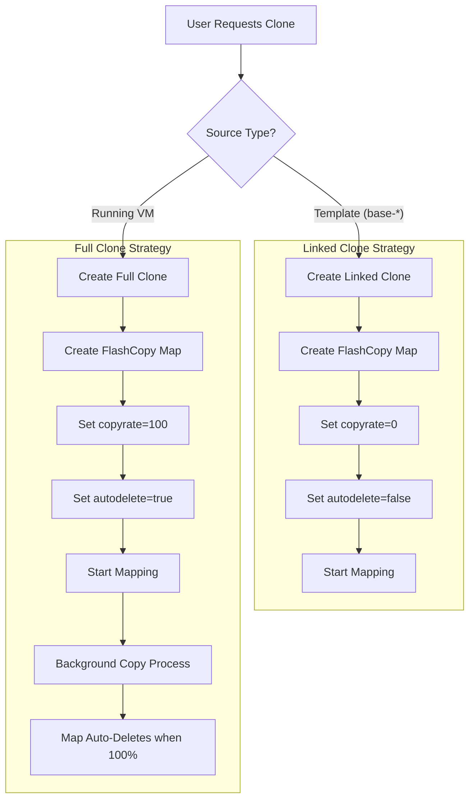
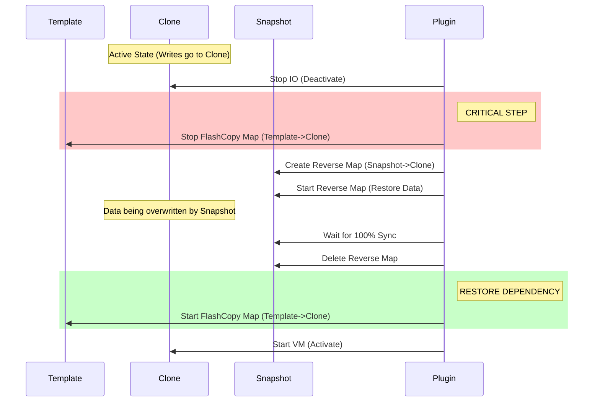

# IBM FlashSystem FlashCopy Architecture in Proxmox VE

This document details the architectural implementation of FlashCopy for the Proxmox VE plugin, covering Cloning strategies, Snapshot lifecycles, and Critical Safe-guards.

## 1. Cloning Strategy

 The plugin implements a hybrid cloning strategy to balance performance (speed) with data safety and snapshot compatibility.

### 1.1 Decision Logic

| Source Type | Action | CopyRate | AutoDelete | Result |
|-------------|--------|----------|------------|--------|
| **Template** (`base-*`) | **Linked Clone** | `0` | `false` | Instant clone, dependent on source. |
| **Running VM** | **Full Clone** | `100` | `true` | Independent copy, background copy process. |
| **VM with Snapshots** | **Full Clone** | `100` | `true` | Ensures clean state, avoids massive dependency trees. |

### 1.2 Visual Flow

## 2. Snapshot Architecture

Snapshots utilize FlashCopy with `copyrate=0` to create efficient point-in-time copies.

### 2.1 Snapshot Creation
When a snapshot is taken, a new volume is created, and a FlashCopy map is established from the **Source Volume** to the **Snapshot Volume**.

### 2.2 Rollback Mechanism (The "Manual Reverse-Sync")

Rolling back is complex because IBM FlashSystem allows mappings to be active. 

#### Scenario A: Standard Rollback (Independent Volume)
1. Stop IO.
2. Delete existing FlashCopy maps involves the volume.
3. Create "Reverse Map" (Snapshot -> Volume).
4. Start Reverse Map with `copyrate=150` (high priority).
5. Wait for sync.
6. Delete Reverse Map.

#### Scenario B: Linked-Clone Rollback (Dependent Volume)
Linked clones have an active "Base Map" (Template -> Clone) that **cannot** exist simultaneously with a "Reverse Map" (Snapshot -> Clone) if both write to the Clone.

**Solution:** The "Pause & Patch" Protocol.

## 3. Limitations & Constraints

### 3.1 Template Protection
You cannot delete a Template (`base-*`) if it has active Linked Clones. This is enforced to prevent data corruption, as linked clones depend on the template reading reference data.

**Error Message:**
> `Cannot delete template 'base-100-disk-0': has dependent linked-clone volumes: vm-101-disk-0`

### 3.2 Snapshot Depth
While IBM FlashSystem supports cascaded mappings, this plugin manages a flat snapshot structure relative to the volume to maintain performance and simplify rollback logic.

### 3.3 Offline Operations
Most heavy operations (Rollback) require the VM to be powered off to ensure data consistency and lock the volume structure.

## 4. Summary of Operations

| Operation | Implementation | Consistency |
|-----------|----------------|-------------|
| **Clone from Template** | Linked Clone (`CR=0`) | **Instant**, COW logic. |
| **Clone from VM** | Full Copy (`CR=100`) | **Slower**, but creates independent volume. |
| **Snapshot** | FlashCopy (`CR=0`) | Instant. |
| **Rollback** | Reverse FlashCopy | **Wait-for-sync** required. |
| **Delete** | Cleanup Script | Removes Volumes, Maps, and Host/Multipath devices. |
