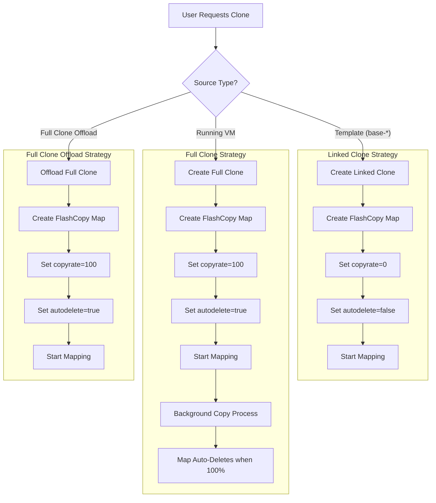
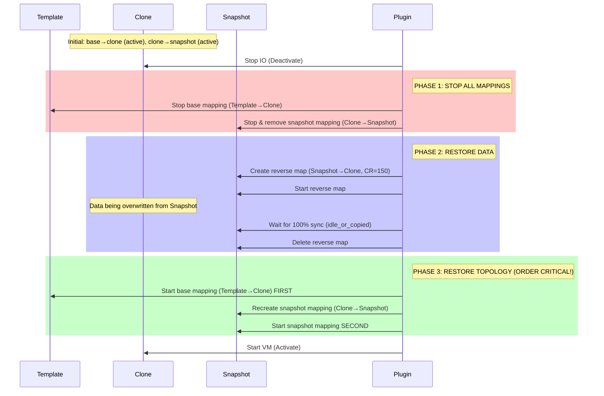

# IBM FlashSystem FlashCopy Architecture in Proxmox VE

This document details the architectural implementation of FlashCopy for the Proxmox VE plugin, covering Cloning strategies, Snapshot lifecycles, and Critical Safe-guards.

## 1. Cloning Strategy

The plugin implements a hybrid cloning strategy to balance performance (speed) with data safety and snapshot compatibility, with optional offload for full clones when PVE patches are installed.
Offload full clone is used only when source and target are on the same storage and the storage reports `copy` with `offload` support (cloud-init disks excluded).

### 1.1 Decision Logic

| Source Type | Action | CopyRate | AutoDelete | Result |
|-------------|--------|----------|------------|--------|
| **Template** (`base-*`) | **Linked Clone** | `0` | `false` | Instant clone, dependent on source. |
| **Running VM** | **Full Clone** | `100` | `true` | Independent copy, background copy process. |
| **VM with Snapshots** | **Full Clone** | `100` | `true` | Ensures clean state, avoids massive dependency trees. |
| **Full Clone (Offload)** | **PVE vdisk_clone** | `100` | `true` | Same storage with offload support, no qemu-img copy. |

### 1.2 Visual Flow



## 2. Snapshot Architecture

Snapshots utilize FlashCopy with `copyrate=0` to create efficient point-in-time copies.

### 2.1 Snapshot Creation
When a snapshot is taken, a new volume is created, and a FlashCopy map is established from the **Source Volume** to the **Snapshot Volume**.

When cloning from a snapshot (linked clone with a snapshot name), the plugin uses the snapshot volume as the FlashCopy source.

### 2.2 Rollback Mechanism (The "Manual Reverse-Sync")

Rolling back is complex because IBM FlashSystem has strict rules about FlashCopy topology:
- A volume can be both a **source** and a **target** simultaneously
- But you **cannot start** a mapping where the target is already an **active source** in another mapping (`CMMVC9055E`)

#### Scenario A: Standard Rollback (Full Clone / Independent Volume)

Full clones have no base mapping dependency. They may have snapshot mappings.

**Topology before rollback:**
```
vm-200-disk-0 (independent)
    └── snap-vm-200-disk-0-snap1 (fcmap: vm-disk → snapshot, copyrate=0)
```

**Algorithm:**
1. Stop IO (Deactivate volume)
2. Stop and remove all snapshot mappings (volume as source)
3. Create reverse map: `Snapshot -> Volume` with `copyrate=150`
4. Start reverse map, wait for `idle_or_copied` (100% sync)
5. Delete reverse map
6. Recreate snapshot mappings: `Volume -> Snapshot` with `copyrate=0`
7. Start snapshot mappings
8. Start VM (Activate)

#### Scenario B: Linked-Clone Rollback (Dependent Volume)

Linked clones have an active "Base Map" (Template → Clone) that creates a dependency chain.

**Topology before rollback:**
```
base-100-disk-0 (template)
    │
    │ fcmap 0 (base → clone, copyrate=0) ← BASE MAPPING
    ↓
vm-200-disk-0 (linked clone)
    │
    │ fcmap 1 (clone → snapshot, copyrate=0) ← SNAPSHOT MAPPING
    ↓
snap-vm-200-disk-0-snap1
```

**Critical constraint (`CMMVC9055E`):**
- Cannot start base mapping (where clone is **target**) while clone is an **active source** in snapshot mapping
- Order matters: base mapping must be started **before** snapshot mappings

**Algorithm:**
1. Stop IO (Deactivate volume)
2. **Stop base mapping** (Template → Clone)
3. Stop and remove all snapshot mappings (Clone → Snapshots)
4. Create reverse map: `Snapshot -> Clone` with `copyrate=150`
5. Start reverse map, wait for `idle_or_copied` (100% sync)
6. Delete reverse map
7. **Start base mapping first** (Template → Clone) ← CRITICAL ORDER
8. Recreate and start snapshot mappings (Clone → Snapshots)
9. Start VM (Activate)

**Visual Flow:**



#### Why Order Matters

IBM FlashSystem enforces this constraint:
```
CMMVC9055E: The command failed because a target volume has dependent FlashCopy mappings.
```

This error occurs when trying to start a mapping where the **target** volume is already an **active source** in another mapping.

| Step | Clone Role | Allowed? |
|------|------------|----------|
| Start base mapping (base → clone) | clone = target | ✅ Yes (clone not active source) |
| Start snapshot mapping (clone → snap) | clone = source | ✅ Yes (can be both target and source) |
| Start snapshot first, then base | clone = active source, then target | ❌ `CMMVC9055E` |

#### Transaction Recovery

The plugin saves rollback state to `/run/pve-ibm-rollback-$volname.json` for crash recovery:
- Phase tracking: `removing_mappings`, `creating_reverse`, `restoring`, `recreating_mappings`
- Orphaned reverse mappings are cleaned up on retry
- Base mapping is restored if rollback was interrupted

## 3. Limitations & Constraints

### 3.1 Template Protection
You cannot delete a Template (`base-*`) if it has active Linked Clones. This is enforced to prevent data corruption, as linked clones depend on the template reading reference data.

**Error Message:**
> `Cannot delete template 'base-100-disk-0': has dependent linked-clone volumes: vm-101-disk-0`

### 3.2 Snapshot Depth
While IBM FlashSystem supports cascaded mappings, this plugin manages a flat snapshot structure relative to the volume to maintain performance and simplify rollback logic.

### 3.3 Offline Operations
Most heavy operations (Rollback) require the VM to be powered off to ensure data consistency and lock the volume structure.

## 4. Summary of Operations

| Operation | Implementation | Consistency |
|-----------|----------------|-------------|
| **Clone from Template** | Linked Clone (`CR=0`) | **Instant**, COW logic. |
| **Clone from VM** | Full Copy (`CR=100`) | **Slower**, but creates independent volume. |
| **Snapshot** | FlashCopy (`CR=0`) | Instant. |
| **Rollback** | Reverse FlashCopy | **Wait-for-sync** required. |
| **Delete** | Cleanup Script | Removes Volumes, Maps, and Host/Multipath devices. |
