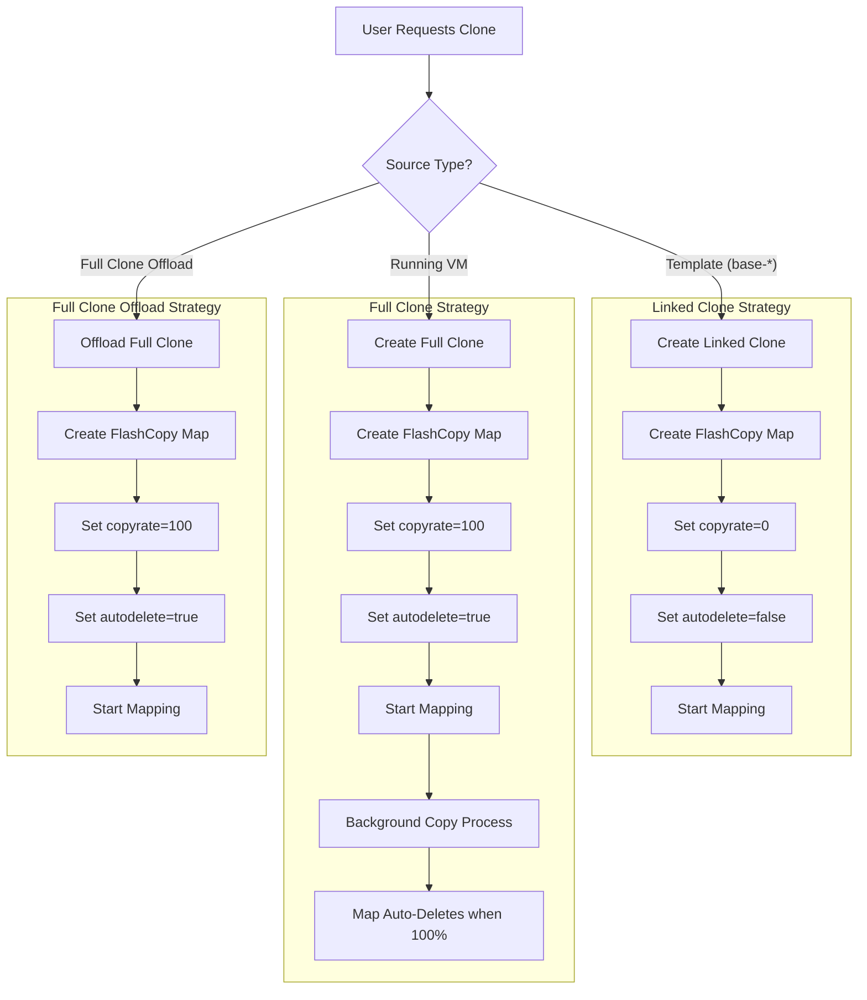
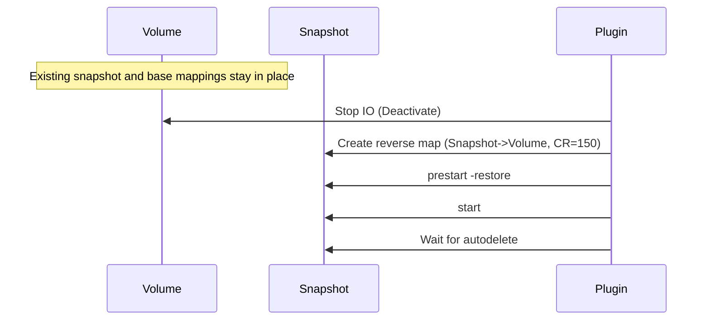

# IBM FlashSystem FlashCopy Architecture in Proxmox VE

This document details the architectural implementation of FlashCopy for the Proxmox VE plugin, covering Cloning strategies, Snapshot lifecycles, and Critical Safe-guards.

## 1. Cloning Strategy

The plugin implements a hybrid cloning strategy to balance performance (speed) with data safety and snapshot compatibility, with optional offload for full clones when PVE patches are installed.
Offload full clone is used only when source and target are on the same storage and the storage reports `copy` with `offload` support (cloud-init disks excluded).

### 1.1 Decision Logic

| Source Type | Action | CopyRate | AutoDelete | Result |
|-------------|--------|----------|------------|--------|
| **Template** (`base-*`) | **Linked Clone** | `0` | `false` | Instant clone, dependent on source. |
| **Running VM** | **Full Clone** | `100` | `true` | Independent copy, background copy process. |
| **VM with Snapshots** | **Full Clone** | `100` | `true` | Ensures clean state, avoids massive dependency trees. |
| **Full Clone (Offload)** | **PVE vdisk_clone** | `100` | `true` | Same storage with offload support, no qemu-img copy. |

### 1.2 Visual Flow

## 2. Snapshot Architecture

Snapshots utilize FlashCopy with `copyrate=0` to create efficient point-in-time copies.

### 2.1 Snapshot Creation
When a snapshot is taken, a new volume is created, and a FlashCopy map is established from the **Source Volume** to the **Snapshot Volume**.

When cloning from a snapshot (linked clone with a snapshot name), the plugin uses the snapshot volume as the FlashCopy source.

### 2.2 Rollback Mechanism (Restore Mapping)

Rollback uses a temporary reverse FlashCopy mapping with `prestartfcmap -restore`. The restore flag forces the
mapping to prepare even if the target volume is an active source in another mapping, so the plugin keeps existing
snapshot mappings (and any base mapping for linked clones) in place.

#### Algorithm (All Cases)

1. Stop IO (Deactivate volume)
2. Ensure the snapshot mapping exists (`Volume -> Snapshot`, copyrate=0)
3. Create temporary reverse map: `Snapshot -> Volume` with `copyrate=150`, `cleanrate=150`, `autodelete=true`
4. `prestartfcmap -restore`, then `startfcmap`
5. Wait for the mapping to complete and autodelete

#### Why `-restore`

IBM FlashSystem allows `-restore` to prepare a mapping even when the target is an active source in another mapping.
If the target is not a source in another mapping, the flag is ignored. This avoids teardown/rebuild of snapshot/base
maps and eliminates `CMMVC9055E` ordering issues.

#### Visual Flow

## 3. Limitations & Constraints

### 3.1 Template Protection
You cannot delete a Template (`base-*`) if it has active Linked Clones. This is enforced to prevent data corruption, as linked clones depend on the template reading reference data.

**Error Message:**
> `Cannot delete template 'base-100-disk-0': has dependent linked-clone volumes: vm-101-disk-0`

### 3.2 Snapshot Depth
While IBM FlashSystem supports cascaded mappings, this plugin manages a flat snapshot structure relative to the volume to maintain performance and simplify rollback logic.

### 3.3 Offline Operations
Most heavy operations (Rollback) require the VM to be powered off to ensure data consistency and lock the volume structure.

## 4. Summary of Operations

| Operation | Implementation | Consistency |
|-----------|----------------|-------------|
| **Clone from Template** | Linked Clone (`CR=0`) | **Instant**, COW logic. |
| **Clone from VM** | Full Copy (`CR=100`) | **Slower**, but creates independent volume. |
| **Snapshot** | FlashCopy (`CR=0`) | Instant. |
| **Rollback** | Reverse FlashCopy (restore mapping) | **Wait-for-sync** required. |
| **Delete** | Cleanup Script | Removes Volumes, Maps, and Host/Multipath devices. |
